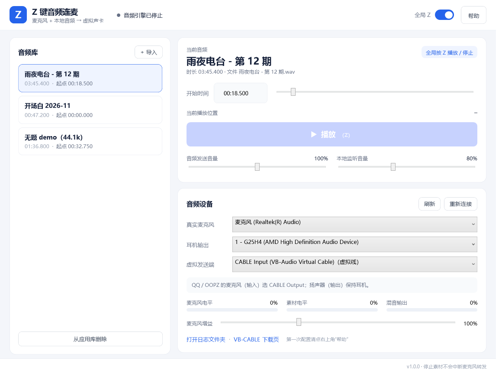

# Z 键音频连麦

Windows 11 桌面小工具：把**真实麦克风**和**本地音频素材**在应用内混音，写入 VB-CABLE 的 `CABLE Input`，让 QQ / OOPZ 的对方同时听到你的说话和素材；素材另有一路只送到你的耳机。软件运行时全局按 `Z` 播放 / 停止，窗口可以隐藏到托盘。



## 当前状态（请先读这一节）

- 源码可编译，已发布自包含 `win-x64` 包，并在**没有安装系统 .NET** 的当前机器上通过自包含启动验证。
- **58 个自动化测试全部通过**，覆盖混音、限幅、起播/停止/自然结束、取消竞态、设置原子保存、导入/去重、时间码解析、Z 键去重、CABLE 设备识别等可离线验证的部分。
- 已安装官方基础版 VB-CABLE（Pack45）并重启；`CABLE Input → CABLE Output` 回路自测通过。
- 已在真实发布包上验证：**全局 Z 起播、停止、再次起播**；素材以 1 kHz / 0.2 幅度进入 CABLE Output；监听音量为 0 时发送不受影响；3 秒长按只触发一次；应用最小化时 Z 仍有效。
- **OOPZ 已由用户实测**：关闭 OOPZ 的 AI 智能降噪/回声消除后，对方评价“音质完美”；但还没有按 A08 逐项记录同时说话+素材、回声等步骤。
- **QQ 对端通话仍未测**，耳机端点当前未连接；完整 A07/A08、60 分钟稳定性等仍未完成。详细证据与未测项见 `docs/测试记录.md`。
- 不能把这套代码描述为“已经满足全部连麦要求”，直到 QQ 真实对端测试也完成。

## 交付物

| 路径 | 内容 |
| --- | --- |
| `src/ZKeyAudioLink.App` | WPF 主程序、托盘、Raw Input 全局 Z |
| `src/ZKeyAudioLink.Core` | 音频引擎、混音、状态机、媒体库、配置、设备 |
| `src/ZKeyAudioLink.Doctor` | 验证工具：设备枚举、离线渲染、CABLE 回路 / 捕获 |
| `tests/ZKeyAudioLink.Tests` | 58 个 xUnit 测试 |
| `publish/ZKeyAudioLink-win-x64.zip` | 自包含可运行包（解压双击） |
| `docs/` | 使用说明、构建说明、测试记录、技术设计、第三方许可 |

## 快速开始

1. 按 `docs/用户使用说明.md` 安装官方基础版 VB-CABLE（需要管理员权限和重启）。
2. 解压 `publish/ZKeyAudioLink-win-x64.zip`，双击 `ZKeyAudioLink.exe`。
3. 在软件中选择：真实麦克风、耳机输出、虚拟发送端 `CABLE Input`。
4. 把 QQ / OOPZ 的**麦克风输入**选为 `CABLE Output`，输出保持耳机。
5. 导入音频、选中条目、设置开始时间，按 `Z` 播放并同时说话。

## 构建与测试

本机使用 `D:\Code\.dotnet` 下的 .NET 10 SDK（不写入系统 PATH）：

```powershell
$env:DOTNET_CLI_HOME='D:\Code\.dotnet-home'
$env:TMP='D:\Code\.tmp'; $env:TEMP='D:\Code\.tmp'
& 'D:\Code\.dotnet\dotnet.exe' build ZKeyAudioLink.slnx
& 'D:\Code\.dotnet\dotnet.exe' test tests\ZKeyAudioLink.Tests\ZKeyAudioLink.Tests.csproj
& 'D:\Code\.dotnet\dotnet.exe' publish src\ZKeyAudioLink.App\ZKeyAudioLink.App.csproj -c Release -r win-x64 --self-contained true -o publish\ZKeyAudioLink-win-x64
```

更多见 `docs/构建与发布.md`。

## 验证工具示例

```powershell
# 枚举设备与格式
dotnet src\ZKeyAudioLink.Doctor\bin\Debug\net10.0-windows\ZKeyAudioLink.Doctor.dll list

# 离线渲染发送流和监听流（不打开播放设备）
dotnet ...\ZKeyAudioLink.Doctor.dll render --in 测试.wav --offset 00:10.000 --out artifacts --mic-tone

# 安装 CABLE 后验证虚拟线回路
dotnet ...\ZKeyAudioLink.Doctor.dll linktest --seconds 3
```

`--screenshot <路径>` 和 `--smoke` 是开发自检参数：前者离屏渲染主窗口，后者不开窗口启动真实音频引擎后退出，均不发送按键、不修改系统默认设备。

## 已知限制

- 锁屏、UAC 安全桌面、管理员窗口和部分带输入保护的游戏可能收不到全局 Z；不绕过游戏防护。
- 首版只承诺 WAV（PCM / IEEE Float）和 MP3；MP3 seek 精度受解码器影响。
- 不捆绑驱动、不静默安装、不改系统默认设备。
- 端到端通话与 60 分钟稳定性仍需按 `docs/测试记录.md` 补测。

## 第三方与授权

- NAudio 3.3.0：MIT。
- .NET 10 / WPF：MIT。
- VB-CABLE 基础版：VB-Audio 的捐赠软件，个人使用可免费；专业用途需要付费授权。本软件不捆绑、不静默安装驱动。

完整说明与链接见 `docs/第三方许可.md`。


